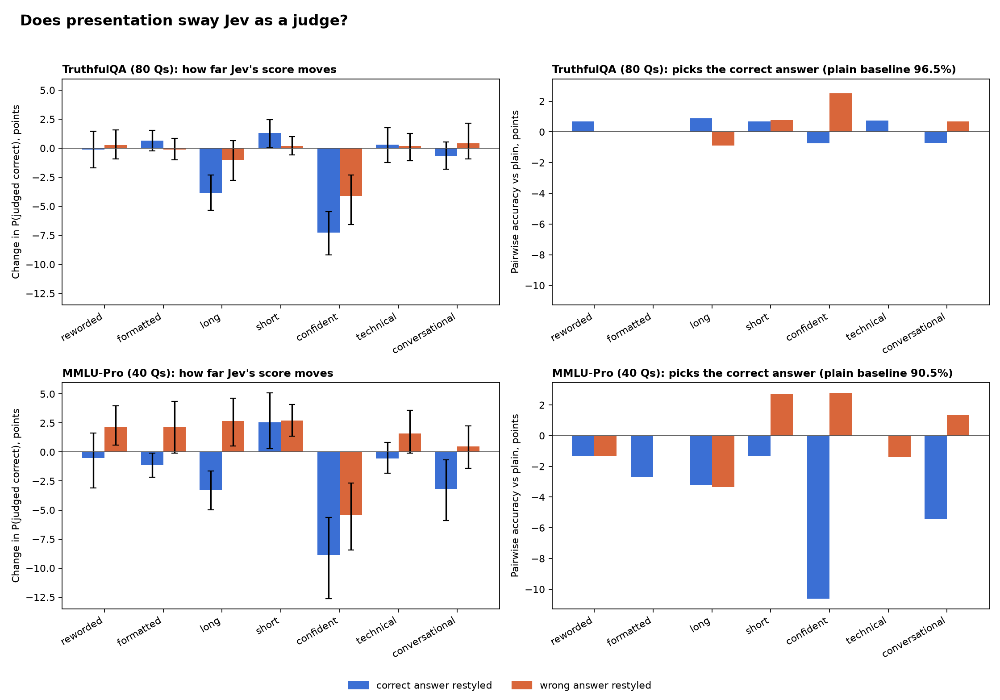

# Does answer presentation sway Jev as a judge?

A small experiment testing whether [Jev](https://openrouter.ai) (`typesafe/jev-1.14`, via OpenRouter's decisions API) judges what an answer says or how it is written.

Each question has one correct and one wrong answer. Every answer is rewritten in seven styles (reworded, formatted, long, short, confident, technical, conversational) with the facts held fixed. We then measure how much Jev's verdicts and probabilities move.



## Findings

Two question sets: TruthfulQA (80 questions) and MMLU-Pro knowledge categories (40 questions, with the wrong answer being the distractor an LLM picked as most tempting).

1. **Jev mostly judges the facts.** With both answers in plain style it picks the correct one 96.5% of the time on TruthfulQA and 90.5% on MMLU-Pro. No style made a wrong answer win.
2. **Confident wording hurts.** "Without question" phrasing lowered Jev's P(correct): about 7 points on TruthfulQA and 9 on MMLU-Pro for correct answers (4 and 5 for wrong ones). On MMLU-Pro, accuracy fell from 89.4% to 78.8% when the correct answer was the confident one.
3. **Style shows up in scores before verdicts.** Most other styles moved scores by about 3 points or less.

Full numbers: [`results/truthfulqa/summary.md`](results/truthfulqa/summary.md), [`results/mmlu_pro/summary.md`](results/mmlu_pro/summary.md). A draft writeup is in [`WRITEUP.md`](WRITEUP.md).

**Caveats:** one run per setting; the MMLU-Pro run has only 37 usable pairs, so treat the size of the confident-wording effect as suggestive and its direction as consistent. Baselines are high, which limits headroom. Rewrites are LLM-generated and fact-checked by another LLM, which dropped some variants (counts in the writeup). The decisions endpoint is alpha.

## How it works

1. **Data** (`data.py`): TruthfulQA best correct / best incorrect answers, or MMLU-Pro correct option vs. an LLM-chosen tempting distractor (math, physics, chemistry and engineering excluded).
2. **Variants** (`styles.py`): an LLM writes a plain answer, then each style rewrite. A second LLM checks the plain answer against the source fact and each rewrite against the plain answer. Failures are excluded and counted.
3. **Absolute run** (`absolute.py`): Jev answers "is this answer factually correct?" (`noul` probability) for each variant.
4. **Pairwise run** (`pairwise.py`): Jev picks the better of a correct and a wrong answer, with one or both restyled, in both A/B orders.
5. **Analysis** (`analyze.py`): shift vs. plain, flip rates, accuracy against a baseline matched to the same questions, bootstrap 95% CIs.

All API responses are cached on disk (`cache/`), so reruns make no repeat calls.

## Run it

Requires [uv](https://docs.astral.sh/uv/) and an OpenRouter key.

```bash
echo "OPENROUTER_API_KEY=sk-or-..." > .env
uv sync
uv run pytest                                   # tests mock the network, no key needed
uv run python run_all.py truthfulqa --n 80      # or: mmlu_pro --n 40
uv run python combine_charts.py                 # builds results/combined_chart.png
```

Running the full pipeline makes thousands of paid API calls (several rewrite, check and Jev calls per question).

## Layout

- `src/jev_bias/`: `client.py` (cached Jev and chat clients), `data.py`, `styles.py`, `absolute.py`, `pairwise.py`, `analyze.py`
- `results/<dataset>/`: raw CSVs, variants, per-dataset chart and `summary.md`
- `docs/superpowers/`: design spec and implementation plan
